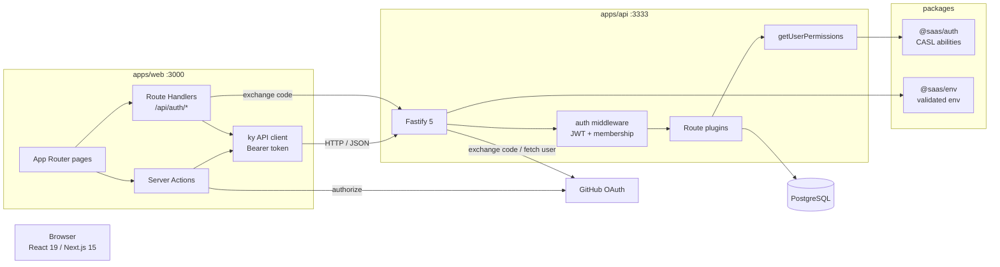
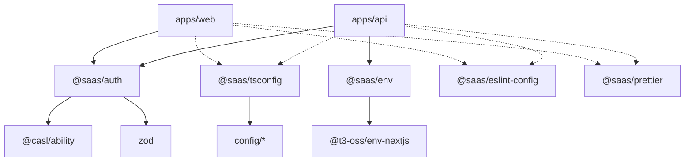
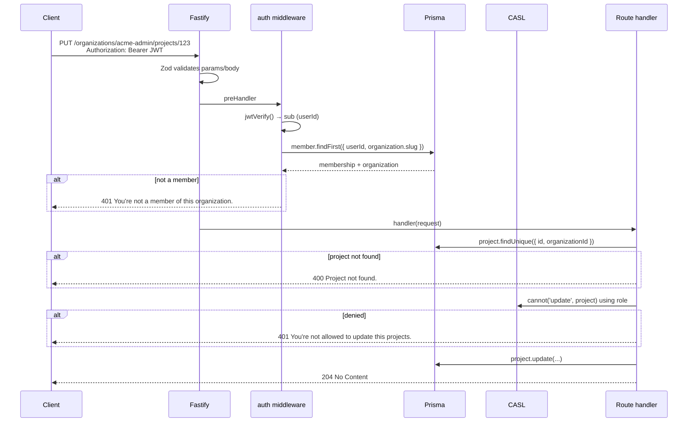
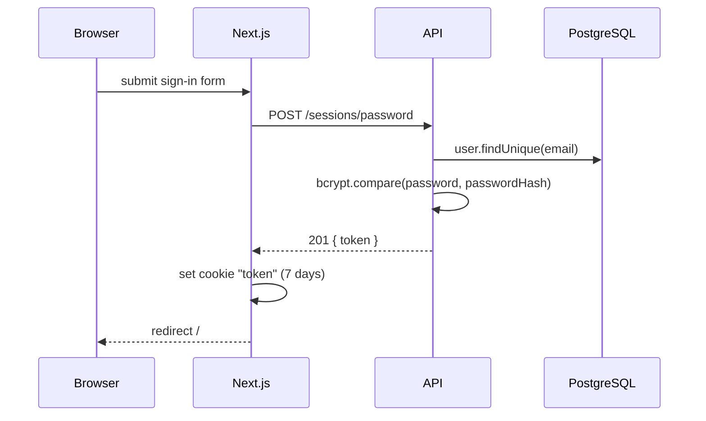
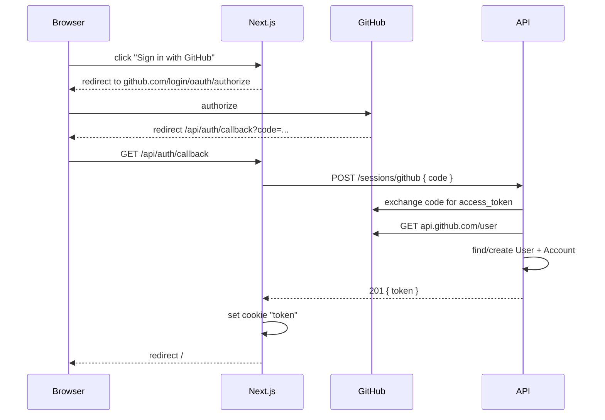
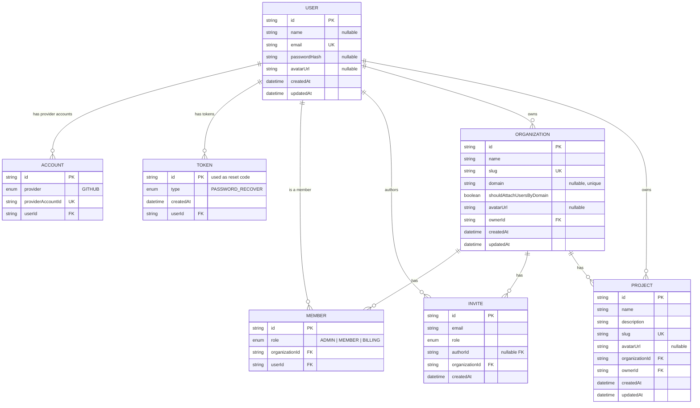

# Architecture

This document explains how the monorepo is organized, how a request flows through the system, how authentication works, and how the data model supports multi-tenancy.

- [System overview](#system-overview)
- [Workspace dependencies](#workspace-dependencies)
- [Request lifecycle](#request-lifecycle)
- [Authentication flows](#authentication-flows)
- [Multi-tenancy model](#multi-tenancy-model)
- [Authorization layer](#authorization-layer)
- [Data model](#data-model)
- [API design conventions](#api-design-conventions)
- [Web application](#web-application)
- [Design decisions and trade-offs](#design-decisions-and-trade-offs)

---

## System overview



Two deployable apps:

- **`apps/api`** — stateless JSON API. Owns the database, authentication and authorization.
- **`apps/web`** — server-rendered frontend. It never talks to the database directly; every read/write goes through the API.

Shared code is split between `@saas/auth` (pure authorization logic, no database) and `@saas/env` (environment schema).

---

## Workspace dependencies



`@saas/auth` is consumed **source-first** (`"main": "src/index.ts"`), so both apps compile it directly with their own bundler/runtime. It has no Node- or Prisma-specific imports, which keeps the ability definitions usable on the client in the future.

---

## Request lifecycle

Example: `PUT /organizations/acme-admin/projects/:projectId`.



Key points:

1. **Validation happens before the handler.** Every route declares Zod schemas for `body`, `params` and `query`; route handlers receive typed data.
2. **`auth` is a Fastify plugin registered per protected route.** It decorates the request with:
   - `getCurrentUserId(): Promise<string>` — verifies the JWT and returns `sub`.
   - `getUserMembership(slug): Promise<{ organization, membership }>` — resolves the user's membership in the organization identified by slug.
3. **Authorization is not global middleware.** Each handler loads the resource, then asks CASL whether the current role may perform the action. This allows ownership-aware rules.
4. **Errors are centralized** in `apps/api/src/http/error-handler.ts`.

---

## Authentication flows

### E-mail + password



- Passwords are hashed with **bcryptjs** (cost `6` in the account and reset routes).
- Login responses use `201` (not `200`).
- Users created via GitHub have `passwordHash = null`; password login then returns a clear error telling them to use social login.

### GitHub OAuth



- The API requires the GitHub profile to expose an e-mail; otherwise authentication fails.
- `Account` links `(provider, providerAccountId)` to a user.
- The client ID and callback URL in the web app are currently hardcoded (see [Known limitations](../README.md#known-limitations)).

### Password recovery

1. `POST /password/recover { email }` creates a `Token` row with type `PASSWORD_RECOVER`; its UUID is the reset code.
2. The token is **printed to the server console** — no e-mail provider is integrated.
3. `POST /password/reset { code, password }` hashes the new password, updates the user and deletes the token in a transaction.

The endpoint returns `201` even when the e-mail is unknown, to avoid account enumeration.

---

## Multi-tenancy model

Tenancy is **path-based by organization slug**:

```
/organizations/:slug/...
```

- `Organization` is the tenant boundary.
- `Member` is the join table between `User` and `Organization`, carrying a `role`.
- `Project` and `Invite` always belong to exactly one organization.
- Every route containing an organization `:slug` first calls `getUserMembership(slug)`, which both authenticates and authorizes membership. A user outside the organization receives `401`.

The database is **shared** (single schema); isolation is enforced in application code, not by row-level security. When adding a new tenant-scoped table, always include `organizationId` and filter by it.

### Automatic domain join

When a user signs up with e-mail `someone@acme.com`, the API looks for an organization with:

```ts
{ domain: "acme.com", shouldAttachUsersByDomain: true }
```

If found, a `Member` row is created in the same transaction as the user (via a nested Prisma write). This is also why creating an invite for an e-mail on an auto-join domain is rejected.

---

## Authorization layer

```
JWT → userId
     ↓
Member(organizationId, userId) → role
     ↓
getUserPermissions(userId, role)
     ↓
defineAbilityFor({ id, role }) → CASL Ability
     ↓
cannot(action, subject) → allow / deny
```

- Ability definitions: `packages/auth/src/permissions.ts`
- Subjects and valid actions: `packages/auth/src/subjects/*.ts`
- Subject models: `packages/auth/src/models/*.ts`
- API helper: `apps/api/src/utils/get-user-permissions.ts`

The ability is built **per request**. There is no caching or session-level permission object.

See [RBAC reference](./rbac.md) for the full matrix and the pattern for adding permissions.

---

## Data model



### Constraints and delete behavior

| Relation | Behavior |
| --- | --- |
| `Member(organizationId, userId)` | unique — one membership per user per organization |
| `Invite(email, organizationId)` | unique — one pending invite per e-mail per organization |
| `Account(provider, userId)` | unique; `providerAccountId` globally unique |
| `Organization.domain` | unique when present |
| `Project.slug`, `Organization.slug` | globally unique |
| User deletion | cascades `Token`, `Account`, `Member`, and nulls `Invite.author` |
| Organization deletion | cascades `Member`, `Invite`, `Project` |
| Organization/Project owner deletion | **restricted** — ownership must be transferred first |

> Because project and organization slugs are globally unique (not scoped per organization), `createSlug(name)` can collide. The API does not currently catch `P2002` conflicts; the generic handler returns `500`.

---

## API design conventions

### One file per endpoint

```
apps/api/src/http/routes/
├── auth/         create-account, authenticate-with-password, authenticate-with-github,
│                 get-profile, request-password-recover, reset-password
├── orgs/         create, get, get-membership, get-organizations,
│                 update, shutdown, transfer
├── members/      get-members, update-member, remove-member
├── projects/     create, get, get-project, update, delete
├── invites/      create, get, get-invites, get-pending, accept, reject, revoke
├── billing/      get-organization-billing
└── _errors/      bad-request-error, unauthorized-error
```

Each file exports an async Fastify plugin:

```ts
export async function createProject(app: FastifyInstance) {
  app
    .withTypeProvider<ZodTypeProvider>()
    .register(auth)               // only for protected routes
    .post('/organizations/:slug/projects', {
      schema: {
        tags: ['projects'],
        summary: 'Create a new project',
        security: [{ bearerAuth: [] }],
        params: z.object({ slug: z.string() }),
        body: z.object({ name: z.string(), description: z.string() }),
        response: { 201: z.object({ projectId: z.uuid() }) },
      },
    }, async (request, reply) => {
      // 1. authenticate   2. load membership   3. check ability   4. persist
    })
}
```

Register new routes in `apps/api/src/http/server.ts`.

### OpenAPI

Zod schemas are converted to JSON Schema by `jsonSchemaTransform`. Swagger UI is served at `/docs`; the generated document describes every route, including auth requirements.

### Errors

| Status | When | Body |
| --- | --- | --- |
| `400` | Zod validation failure | `{ "message": "Validation Error", "errors": ... }` |
| `400` | Business rule (`BadRequestError`) | `{ "message": "..." }` |
| `401` | Invalid/missing token, not a member, permission denied (`UnauthorizedError`) | `{ "message": "..." }` |
| `500` | Unhandled error | `{ "message": "Internal server error." }` |

Permission failures intentionally use `401` rather than `403` in the current implementation.

---

## Web application

```
apps/web/src/
├── app/
│   ├── layout.tsx                 # Root layout, dark theme, Geist font
│   ├── page.tsx                   # Calls auth(), renders the profile JSON
│   ├── auth/
│   │   ├── layout.tsx             # Redirects authenticated users to /
│   │   ├── actions.tsx            # GitHub redirect server action
│   │   ├── sign-in/               # Form + server action
│   │   ├── sign-up/               # Static form (not wired)
│   │   └── forgot-password/       # Static form (not wired)
│   ├── api/auth/
│   │   ├── callback/route.ts      # GitHub OAuth callback
│   │   └── sign-out/route.ts      # Clears cookie
│   ├── hooks/use-form-state.ts    # useTransition-based form helper
│   └── globals.css
├── auth/auth.ts                   # isAuthenticated(), auth()
├── http/                          # ky client + endpoint wrappers
└── components/ui/                 # Buttons, inputs, alerts, separators
```

**Session handling**

- `token` cookie, 7-day `maxAge`, no other flags.
- `isAuthenticated()` checks for the cookie only (used by the auth layout).
- `auth()` calls `GET /profile`; on failure it redirects to `/api/auth/sign-out`, which clears the cookie and sends the user to `/auth/sign-in`.
- `auth()` is a server-only helper (uses `next/headers`).

**API client**

`src/http/api-client.ts` creates a `ky` instance with:

- `prefix: http://localhost:3333` (hardcoded),
- a `beforeRequest` hook that reads the cookie on the server via `next/headers` (and via `cookies-next` in the browser),
- automatic `Authorization: Bearer <token>`.

Endpoint wrappers (`sign-in-with-password.ts`, `sign-in-with-github.ts`, `get-profile.ts`) declare request/response types.

---

## Design decisions and trade-offs

| Decision | Why | Consequence |
| --- | --- | --- |
| Separated API and web apps | Independent scaling/deployment; API reusable by mobile/CLI | More moving parts; CORS and token handling needed |
| JWT in a cookie, stateless | Simple, no session table | Revocation is impossible until expiry; logout only deletes the cookie |
| CASL for RBAC | Declarative, testable, ownership-aware conditions | Ability must be rebuilt per request; type safety depends on Zod models |
| Zod for HTTP + RBAC | One source of truth, OpenAPI generation for free | Schemas describe wire format, not domain invariants |
| Application-level tenancy | Simpler than PostgreSQL RLS, works with Prisma | Every query must include the tenant filter manually |
| Prisma 7 driver adapter | Explicit connection handling with `pg` | Slightly more setup than the default engine |
| Source-first shared package | No build step for `@saas/auth` | Consumers must transpile it; not publishable as-is |

For concrete gaps and bugs, see [Known limitations](../README.md#known-limitations).
